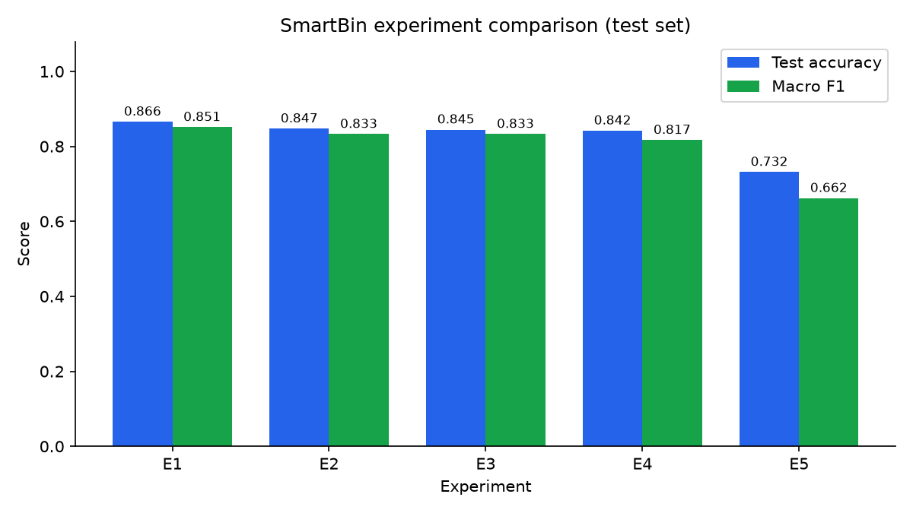
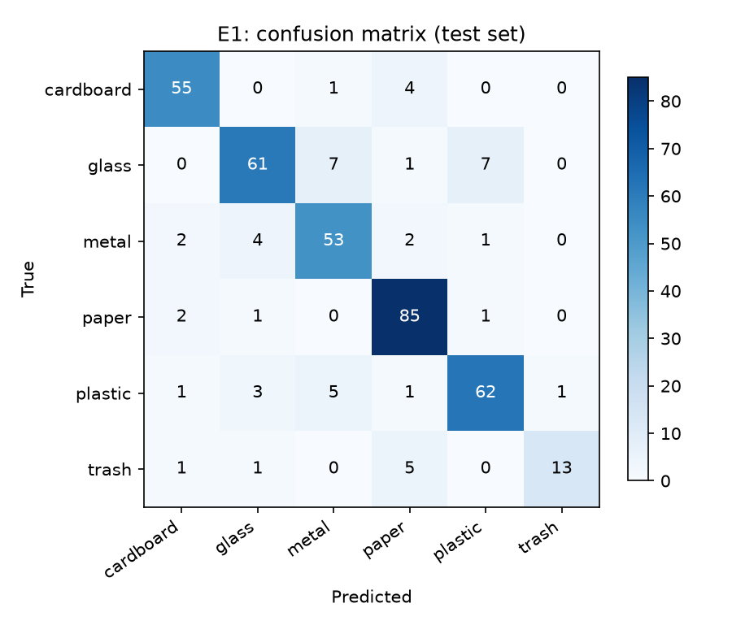

# SmartBin

An image classifier that looks at a photo of one waste item and says which bin it belongs in. Built for ICT Assignment 2 (requirement option 1: an open-source dataset with a modified algorithm, comparing the results).

**Best model:** VGG16 transfer learning (experiment E1), **86.6 % test accuracy**, macro F1 0.851.

## Dataset

[TrashNet](https://github.com/garythung/trashnet) by Gary Thung and Mindy Yang: 2,527 photos of single items on a white background.

| cardboard | glass | metal | paper | plastic | trash |
|---|---|---|---|---|---|
| 403 | 501 | 410 | 594 | 482 | 137 |

The split is stratified 70 / 15 / 15 (1,768 train, 379 validation, 380 test) with seed 42, saved in `splits.csv` so every experiment uses the same images. We report macro F1 next to accuracy because the `trash` class is small.

## Experiments

Each experiment changes one thing from the one before it. All ran for 10 epochs with batch size 32 and kept the weights with the best validation accuracy.

| ID | What changed | Trainable parameters | Test accuracy | Macro F1 | `trash` F1 | Training time |
|----|---|---:|---:|---:|---:|---:|
| **E1** | Baseline: frozen VGG16 features, last layer changed to 6 classes, SGD | 119,570,438 | **86.6 %** | **0.851** | 0.765 | 285 s |
| E2 | Smaller head: `Linear(25088→1024)`, ReLU, `Dropout(0.3)`, `Linear(1024→6)` | 25,697,286 | 84.7 % | 0.833 | 0.743 | 276 s |
| E3 | Optimiser: Adam, lr 1e-4, instead of SGD | 25,697,286 | 84.5 % | 0.833 | 0.757 | 280 s |
| E4 | Fine-tuning: last conv block unfrozen, lr 1e-5 for conv and 1e-4 for head | 32,776,710 | 84.2 % | 0.817 | 0.645 | 303 s |
| E5 | Different architecture: frozen MobileNetV2 | 7,686 | 73.2 % | 0.662 | 0.261 | 253 s |

Times are from an RTX 4060 laptop GPU.



### What we learned

- **Smaller head (E1→E2):** about 4.6× fewer trainable parameters cost 1.8 points of accuracy. The saved model shrinks from 537 MB to 162 MB.
- **Optimiser (E2→E3):** Adam and SGD gave practically the same result.
- **Fine-tuning (E3→E4):** this did not help. Training accuracy reached 99.8 % while validation stayed at 84.4 %, which is overfitting, and `trash` F1 fell to 0.645. With only about 1,800 training images, the extra trainable layers memorised the data.
- **MobileNetV2 (E5):** training accuracy was only 77.6 % at epoch 10 and still rising, so this model was under-trained rather than simply worse. More epochs or a higher learning rate may narrow the gap.

### Confusion matrix of the best model



The most common mistakes are glass predicted as metal or plastic (7 each) and plastic predicted as metal (5). `trash` is the weakest class: 13 of 20 are correct, and 5 are predicted as paper.

## Limitations

- **Small differences between E1–E4 are not conclusive.** Each experiment ran once, with one seed. E1 and E4 differ by 9 of 380 test images, and the 95 % margin on 86.6 % is about ±3.4 points.
- **86.6 % is slightly optimistic.** The best model was chosen using test accuracy, so the test set is not fully independent of that choice. By validation accuracy alone, E4 (84.4 %) would edge out E1 (83.6 %).
- **Real photos may score lower.** TrashNet photos show one item on a white background. The model has not been measured on phone photos with cluttered backgrounds.
- **It can't recognise things that aren't waste.** It always picks one of the 6 classes. The "Not sure" warning appears when the top probability is below 50 %, but it doesn't catch everything: a pure-noise image got "cardboard, 86 %" with no warning.
- **Bin names and colours are illustrative.** They are not an official Kazakhstan standard.

## Run the app

Python 3.10 or newer.

```bash
python -m venv .venv
.venv/Scripts/pip install -r requirements.txt
.venv/Scripts/python app.py
```

Then open http://localhost:7860. On macOS or Linux, use `.venv/bin/` instead of `.venv/Scripts/`.

The app needs `weights/best.pt`, which isn't in the repository because it is 537 MB. Copy it from the team's shared folder, or create it by training (below).

## Train the models

```bash
.venv/Scripts/python run_experiments.py
```

This downloads TrashNet and trains every experiment, which takes about 25 minutes on an RTX 4060. If a run is interrupted, run it again: finished experiments are skipped. To start from scratch, delete `results/results.csv`.

`torch` from `requirements.txt` may be a CPU-only build, depending on your platform. To train on an NVIDIA GPU, install a CUDA build from [pytorch.org](https://pytorch.org/get-started/locally/).

No GPU? Use [`notebooks/smartbin_training.ipynb`](notebooks/smartbin_training.ipynb) on Google Colab. It runs the same code.

## Tests

```bash
.venv/Scripts/python -m pytest
```

The tests run on CPU and don't download pretrained weights.

## Project layout

| File | Purpose |
|---|---|
| `model.py` | Classes, bin info, transforms, and the E1–E5 architectures |
| `data.py` | Dataset download, split, and loaders |
| `train.py` | Optimisers, training loop, and evaluation |
| `report.py` | Charts |
| `run_experiments.py` | Runs the whole pipeline |
| `app.py` | Gradio app |
| `notebooks/` | Colab version of the training run |
| `results/` | Results table, charts, per-class reports, and training logs |
| `Dockerfile` | Optional CPU container for the app (mount `weights/` at `/app/weights`) |
